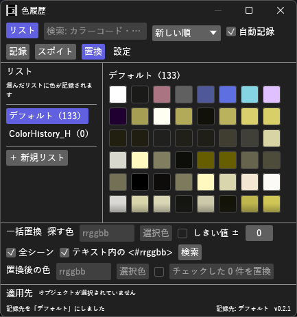

# ColorHistory_H マニュアル

**ColorHistory_H** は、オブジェクトで使った色を覚えておき、クリックでカラーコードをコピーしたり、選択中のオブジェクトへそのまま適用したりできる汎用プラグインです。
色を**リスト**に分けて残せるほか、画面の色を拾う**スポイト**と、プロジェクト内の色の**一括置換**があります。

- **バージョン:** 0.3.0
- **作者:** by HexBrowns
- **必要環境:** AviUtl2 **2.1.10** 以上

本体の「パレット」は使わず、プラグイン専用のファイルに記録します。件数は設定した上限まで増やせます。

---

## 開き方

- **表示** メニュー → **色履歴**

表示リストに出ない場合はAviUtl2を再起動してください。

## 導入

1. [Releases](https://github.com/HexBrowns/ColorHistory_H/releases) から `HexBrowns.ColorHistory_H-v0.3.0.au2pkg.zip` をダウンロードし、AviUtl2のプレビューへドラッグ&ドロップする。
   手で置く場合は、中の `Plugin` フォルダをAviUtl2のデータフォルダへコピーします。`Plugin\ColorHistory_H\ColorHistory_H.aux2` が置かれます。
2. AviUtl2を再起動する。
3. **表示** メニュー → **色履歴** でウィンドウを開く。

v0.2.1 まではzipを展開して置く形でした。上書きで入れ替えて構いません。
履歴と設定はそのまま使えます。

---

## 画面の構成

| 位置 | 内容 |
|------|------|
| 上 | **リスト**、検索欄、並び順、**自動記録**、**記録**、**スポイト**、**置換**、**設定** |
| 左 | **リスト**の一覧と **＋ 新規リスト** |
| 中央 | **ピン留め（件数）** と **選んでいるリスト名（件数）** の色見本 |
| 下 | **一括置換**、**適用先** と **選択色を適用**、ラベル編集欄、状態表示と **記録先** |

色見本の右上の点は**ピン留め**、左下の短い線は**ラベルあり**の印です。

数値や文字の欄は、Enterかほかをクリックしたときに確定します。
入力中にEscを押すと、入力する前の値に戻ります。
検索欄は打つたびに絞り込みます。

## 使い方

### 1. リストを選ぶ

色は**リスト**ごとに分けて残せます。最初は **デフォルト** だけがあります。

- 左の一覧で**クリックしたリストが記録先**になります。以後に記録した色はそのリストにだけ入ります
- 中央に出るのも、選んでいるリストの色です。右下の **記録先:** にリスト名が出ます
- **＋ 新規リスト**: 新しいリストを作り、そのまま記録先にします。名前の欄が開くので、入力してEnterか欄の外をクリックで確定、Escで「新しいリスト」のまま
- リストを**右クリック** → **名前を変更** / **リストを削除**。削除は **もう一度押すと削除** に変わるので、3 秒以内にもう一度押す
- **デフォルト** は名前の変更・削除ができません。記録先のリストを削除すると、記録先はデフォルトに戻ります

使い方の例: 案件ごとにリストを作って選んでおくと、「この案件ではこういう色を使った」が残ります。

### 2. 色を記録する

**自動記録**: オブジェクト設定などで**色を変えると**、その色が記録先のリストに入ります。既定はONです。

- **変えた色だけ**を記録します。オブジェクトを選んだだけでは記録しません
- 色設定ウィンドウで色をドラッグして探している間は記録せず、**マウスを離して色が約 0.5 秒変わらなくなった時点**の色を 1 つだけ記録します
- 透明色は記録しません
- 同じ色は重複させず、使用回数と最後に使った時刻を更新します

**手動で記録する:**

- **記録** ボタン: 選択中オブジェクトの色項目の色を、いまの値ですべて記録します
- **編集** メニュー → **色履歴: 選択中オブジェクトの色を記録**: 同じ動作です。左上メニューの「ショートカットキーの設定」で、**ショートカットキーを割り当てられます**
- **設定** → **色を追加**: カラーコードを入力して **追加** かEnter。ほかをクリックしただけでは追加しません。`ff8000` / `#ff8000` / `0xff8000` / `<#ff8000>` / `255,128,0` のどれでも読めます

### 3. スポイトで画面の色を拾う

オブジェクトの色は**変えずに**、画面上の色を記録先のリストへ入れるだけのスポイトです。

**ボタンから:**

1. **スポイト** ボタンを**押したまま**、拾いたい場所までドラッグする。
2. ボタンの下に、いまカーソルの下にある色が出る。
3. **離した位置の色**が記録される。離す前に **Esc** を押すと中止します。

ボタンをクリックしただけでは何も起きません。

**ショートカットから:**

- **編集** メニュー → **色履歴: カーソル位置の色を記録**。ショートカットキーを割り当てておくと、カーソルを色の上に置いてキーを押すだけで記録できます

拾うのは**画面に表示されている色**です。
プレビューの縮小・なめらかな縁・半透明の重なりの影響を受けるので、オブジェクトに設定した値と少しずれることがあります。
正確な値が必要なときは **記録** を使ってください。

### 4. 色を使う

**クリック**: その色を選択し、カラーコードをクリップボードへコピーします。
オブジェクト設定の色項目のカラーコード欄などへ貼り付けて使います。

**右クリック** で次のメニューが出ます。

| 項目 | 内容 |
|------|------|
| **コピー: …** | 形式を選んでコピー。`rrggbb` / `#rrggbb` / `<#rrggbb>` / `0xrrggbb` / `r,g,b` |
| **フォーカス中のオブジェクトへ適用** | フォーカス中のオブジェクトの色項目を選んで、その色を書き込む |
| **リストへコピー** | 別のリストへ色を写す。ラベルとピン留めも写し、元のリストからは消さない |
| **ピン留め** / **ピン留めを外す** | ピン留めの切り替え |
| **ラベルを編集** | 下にラベル編集欄が出る。**保存** かEnter で確定、**やめる** かEscで取り消し。ほかをクリックしただけでは保存しない |
| **このリストから消す** | その色をいま選んでいるリストから削除 |

- `<#rrggbb>` はテキストオブジェクトの色の制御文字、`0xrrggbb` はLuaスクリプトに書く形式です
- **Ctrl+C**: 色履歴のウィンドウを操作しているとき、選択中の色をコピー
- 色見本にマウスを重ねると、カラーコード・ラベル・RGB・HSV・使用回数・最後に使った時期・最後に使った場所が出ます

### 5. フォーカス中のオブジェクトへ直接適用する

1. タイムラインでオブジェクトを選ぶ。
2. 下の **適用先** で色項目を選ぶ。「テキスト / 文字色（ffffff）」のように現在値も出ます。
3. 色見本をクリックして選択。
4. **選択色を適用**。

- 書き込むのは、**オブジェクト設定に出ているフォーカス中の 1 つだけ**です。複数を選んでいても、ほかのオブジェクトには書きません
- 書き込みは **AviUtl2本体の「元に戻す」で取り消せます**
- 同じ名称のエフェクトが複数あるときは、「縁取り:1 / 縁色」のように 0 始まりで何番目かが付きます
- 適用した色は「使った色」として記録先のリストの先頭へ移ります

### 6. プロジェクト内の色を探して一括置換する

上の **置換** を押すと、下に **一括置換** の欄が開きます。

1. **探す色** にカラーコードを入れる。**選択色** を押すと、いま選んでいる色見本の色が入ります。
2. **しきい値 ±** を決める。
3. **全シーン** と **テキスト内の <#rrggbb>** を必要に応じて切り替える。どちらも既定はONです。
4. **検索** を押すか、**探す色** の欄でEnterを押すと、見つかった箇所が一覧になります。一覧には「シーン名　Lレイヤー　開始〜終了f　場所　見つかった色」が並びます。
5. 置き換える箇所にチェックを入れる。**すべて選択** / **選択解除** もあります。
6. **置換後の色** を入れて、**チェックしたN件を置換**。置換後の色の欄でEnterを押しても置換しません。

| しきい値 | 同じ色とみなす範囲 |
|----------|------------------|
| **0**（既定） | 完全に一致する色だけ |
| **1** | R・G・Bそれぞれの差が 1 以下。`808080` を探すと `7f8180` も見つかる |
| **N** | 各成分の差がN以下。最大 64 |

少しずつずれてしまった同系色を 1 つの色にまとめるときは、しきい値を 1〜数程度にして検索します。

- 置換は **1 回の「元に戻す」でまとめて取り消せます**
- 置換する直前に値を読み直し、**検索したあとに変わっていて条件に合わなくなった箇所は触りません**。状態表示に件数が出ます
- 置換したあとは自動で検索し直します。置き換えた色は記録先のリストに入ります
- **テキスト内の <#rrggbb>**: テキストオブジェクトの本文にある `<#rrggbb>` / `<#rrggbb,rrggbb>` の色も探して置き換えます。色を戻す `<#>` は対象外です
- レイヤー番号とフレーム番号は、タイムラインの表示と同じ 1 始まりで出ます

**他のシーンについて:**

- **置換できるのは、いま表示しているシーンだけです。** 他のシーンの箇所は灰色で「（保存データ・置換不可）」と出て、チェックできません。そのシーンを表示してから検索し直すと置換できます
- 検索した後にシーンを切り替えて置換を押すと、何も書き換えずに知らせます。もう一度検索してください
- 他のシーンは**最後に保存した `.aup2` の内容**から探します。保存していない変更は反映されません。プロジェクトを一度も保存していないときは、他のシーンは探しません

### 7. ピン留めとラベル

- **ピン留め**した色は上の **ピン留め** の欄に並び、**件数の上限を超えても消えません**
- ピン留めした色にラベルを付けると、見本の横にラベルが出ます
- ラベルは検索の対象になります
- ピン留めとラベルはリストごとです

### 8. 並び替えと検索

| 並び順 | 内容 |
|--------|------|
| **新しい順**（既定） | 最後に使った順 |
| **使用回数順** | 使った回数が多い順。同数なら新しい順 |
| **色相順** | 赤→黄→緑→青→紫。灰色など彩度の低い色は最後に明るい順 |

検索欄にはカラーコードの一部、ラベルの一部、`r,g,b` を入れられます。
カラーコードの `#` や `0x` は、付けても付けなくてもかまいません。
検索と並び順は、いま選んでいるリストに効きます。

## 設定

**設定** ボタンで開きます。

| 項目 | 範囲 | 初期値 | 説明 |
|------|------|--------|------|
| **件数の上限** | 16〜10000 | 500 | **1 つのリストあたり**の、ピン留めしていない色の最大件数。超えたら、最後に使ったのが古い色から消えます。打ち込んだ値は、確定してから効きます |
| **見本の大きさ** | 16〜64 px | 28 | 色見本 1 個の大きさ。単位は px |
| **クリックでコピーする形式** | — | rrggbb（カラーコード欄） | クリックとCtrl+Cでコピーする形式 |
| **色を追加** | — | — | カラーコードを入力して記録先のリストへ追加 |
| **このリストのピン留め以外を消去** | — | — | 押すと **もう一度押すと消去** に変わり、3 秒以内にもう一度押すと消去。消えるのは選んでいるリストだけで、ピン留めは残ります |

並び順・**自動記録**・選んでいるリストも保存されます。

## 保存先

- `Plugin\ColorHistory_H\history.json`。**全プロジェクト共通で 1 つ**で、すべてのリストがこのファイルに入ります
- 変更から約 1 秒後、プロジェクト保存時、AviUtl2終了時に書き出します
- ファイルが壊れていて読めないときは、`history.broken-<数字>.json` に名前を変えて残してから空の状態で始めます
- 名前を変えることもできないときは、その起動の間は履歴を保存しません。元のファイルはそのまま残ります。そのことはパネルに出続けます
- v0.1.0 で記録した履歴は、v0.2.0 で読み込んだときに **デフォルト** へ移ります

---

## PaletteHistory との違い

ColorHistory_Hは、`PaletteHistory.aux2` の代わりとして作りました。
`PaletteHistory.aux2` は、オブジェクトを選んだときに本体の編集処理へ割り込むため、**その操作の「元に戻す」が効かなくなる**ことがあります。`reset_frame_selection_on_focus.aux2` も同じです。
ColorHistory_Hは色を**読み取るだけ**で記録するので、この問題は起きません。
本体へ書き込むのは **選択色を適用** と **チェックしたN件を置換** を押したときだけです。

- PaletteHistoryの履歴 `history.palette` を取り込む機能はありません。使っていた色は **設定** → **色を追加** で入れてください
- 色設定ウィンドウにある本体のパレット機能とは連動しません

## 注意事項・既知の制限

- 記録されるのは、フォーカス中の 1 オブジェクトの色だけです。複数選択した他のオブジェクトの色は記録しません
- 自動記録は、同じオブジェクトを選んだまま色を変えたときに働きます。色を変えてから確定する前に別のオブジェクトを選んでも、変えた色は記録されます
- 本体の「元に戻す」で色が戻った場合も、戻った色は「使った色」として記録されます
- ウィンドウを閉じていても記録は続きます。色を読むのは本体で何か変えたときだけで、同じオブジェクトの間は色の項目だけを読みます
- 透明色と黒の間で色を変えたときは、記録が 2 秒ほど遅れることがあります
- 一括置換で置き換えられるのは、表示中のシーンの色項目と、テキスト本文の `<#rrggbb>` です。スクリプト制御欄など、それ以外の文字列の中に書かれた色は探しません

### 確認済み

次の動作をAviUtl2 2.1.11a で確かめました。うまくいかない場合は教えてください。

- オブジェクト設定のカラーコード欄に、コピーした `rrggbb` を貼り付けられる
- 色設定ウィンドウで色を変えたときに、自動記録が働く
- スポイトを色履歴のウィンドウの外までドラッグして離しても、本体側に余計なクリックが伝わらない
- 一括置換で、スクリプトの `--color@` の色の項目とテキスト本文の `<#rrggbb>` が検索に出てくる
